  

  <a href="#about" style="color: #c0b9d8; text-decoration: none;">ABOUT</a>
  &nbsp;·&nbsp;
  <a href="#selected-work" style="color: #c0b9d8; text-decoration: none;">SELECTED WORK</a>
  &nbsp;·&nbsp;
  <a href="#my-approach" style="color: #c0b9d8; text-decoration: none;">MY APPROACH</a>
  &nbsp;·&nbsp;
  <a href="#currently" style="color: #c0b9d8; text-decoration: none;">CURRENTLY</a>

  

<h2 style="font-family: 'Cormorant Garamond', Georgia, serif; font-weight: 300; font-style: italic; font-size: 32px; letter-spacing: 0.5px;">About</h2>

  I'm Melissa Vieira — a developer blending <strong>programming logic</strong> with a background in <strong>multimedia</strong>.

  I bridge the gap between how a digital product feels and how it works behind the scenes.

<strong>QUICK SNAPSHOT</strong>

 

- **Focus** — Front-end, Web Design & UI/UX
- **Roots** — Programming & Multimedia
- **Mindset** — Curiosity, detail & intention

---

<h2 style="font-family: 'Cormorant Garamond', Georgia, serif; font-weight: 300; font-style: italic; font-size: 32px; letter-spacing: 0.5px;">Selected work</h2>

<table>
  <tr>
    <td width="50%" valign="top">
      
01 / INTERNSHIP

      <h3 style="font-family: 'Cormorant Garamond', Georgia, serif; font-weight: 500; font-size: 24px;">Contact Center Experience</h3>
      
Contact Center & Unified Communications solutions developed at Altice.

       
      ANGULAR · FRONT-END
        
      <a href="https://github.com/xMewl/CallCenterPrototype.git" style="font-size: 14px; text-decoration: none;">Explore project ↗</a>
    </td>
    <!--
    <td width="50%" valign="top">
      
02 / PRACTICE

      <h3 style="font-family: 'Cormorant Garamond', Georgia, serif; font-weight: 500; font-size: 24px;">React in Action</h3>
      
Exploring component architecture and reactive interfaces.

       
      REACT · UI DEVELOPMENT
        
      <a href="LINK_PARA_O_REPOSITORIO_REACT" style="font-size: 14px; text-decoration: none;">Explore project ↗</a>
    </td>
    -->
  </tr>
</table>

---

<h2 style="font-family: 'Cormorant Garamond', Georgia, serif; font-weight: 300; font-style: italic; font-size: 32px; letter-spacing: 0.5px;">My approach</h2>

<table>
  <tr>
    <td width="33%" valign="top">
      
01

      <h3 style="font-family: 'Cormorant Garamond', Georgia, serif; font-weight: 500; font-size: 22px;">Explore</h3>
      
Understand the concept and the people behind the screen.

    </td>
    <td width="33%" valign="top">
      
02

      <h3 style="font-family: 'Cormorant Garamond', Georgia, serif; font-weight: 500; font-size: 22px;">Create</h3>
      
Merge structure and visual direction into purposeful UIs.

    </td>
    <td width="33%" valign="top">
      
03

      <h3 style="font-family: 'Cormorant Garamond', Georgia, serif; font-weight: 500; font-size: 22px;">Refine</h3>
      
Polish details, test ideas and elevate the final craft.

    </td>
  </tr>
</table>

---

<h2 style="font-family: 'Cormorant Garamond', Georgia, serif; font-weight: 300; font-style: italic; font-size: 32px; letter-spacing: 0.5px;">Currently</h2>

  Refining front-end skills, exploring micro-interactions, and building interfaces that feel intuitive and alive.

---

  

  DESIGNED WITH INTENTION · BUILT WITH CURIOSITY

