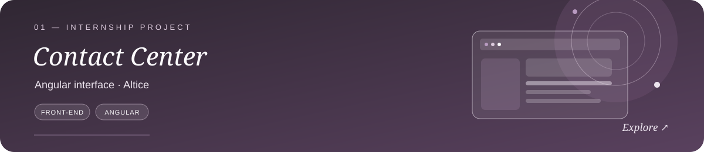
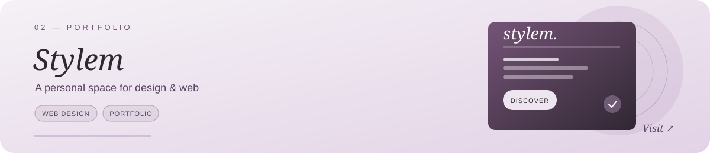
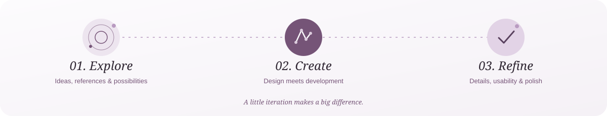

  

  <a href="#about"><i>About</i></a>
  &nbsp; · &nbsp;
  <a href="#toolkit"><i>Toolkit</i></a>
  &nbsp; · &nbsp;
  <a href="#selected-work"><i>Selected work</i></a>
  &nbsp; · &nbsp;
  <a href="#approach"><i>Approach</i></a>
  &nbsp; · &nbsp;
  <a href="#activity"><i>Activity</i></a>

  

<h2 id="about"><i>01 / About</i></h2>

<table>
<tr>
<td width="68%" valign="middle">

### Where design meets development.

I'm **Melissa Vieira**, a developer with a background in Programming and Multimedia.

My interests lie in front-end development, web design and UI/UX — combining technical thinking with a considered approach to visual design and user experience.

</td>
<td width="38%" align="center" valign="middle">

</td>
</tr>
</table>

---

<h2 id="toolkit"><i>02 / Toolkit</i></h2>

<i>Design & visual communication</i>

  
  
  
  

<i>Web development</i>

  
  
  
  
  
  
  

<i>Always learning. Always refining.</i>

---

<h2 id="selected-work"><i>03 / Selected work</i></h2>

<i>Selected projects and experiments in web development and design.</i>

  

<!-- Uncomment when the portfolio project is ready to feature.

  

-->

<!-- Add the React project card when its repository is ready to share. -->

<i>More work in progress ↗</i>

---

<h2 id="approach"><i>04 / Creative process</i></h2>

  

---

<h2 id="activity"><i>05 / GitHub activity</i></h2>

  <i>A little consistency goes a long way.</i>

  

---

<h2 id="currently"><i>06 / Currently exploring</i></h2>

<table>
<tr>
<td width="50%" valign="top">

**01 — Development**

Strengthening my front-end skills and building more polished, responsive web interfaces.

</td>
<td width="50%" valign="top">

**02 — Design**

Exploring the relationship between visual identity, usability and thoughtful interaction.

</td>
</tr>
</table>

  
   
<!--
  
-->
  <!--  -->

  <i>Designed with intention. Developed with curiosity.</i>

